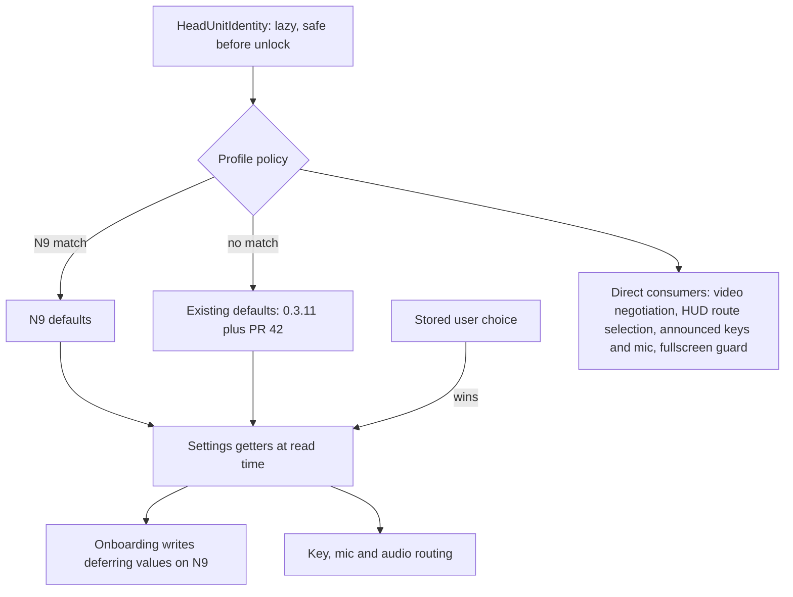
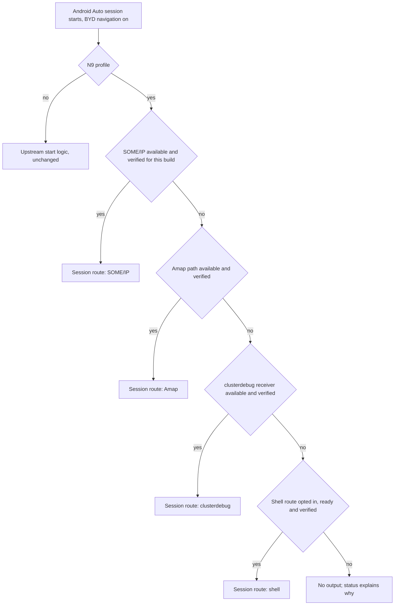
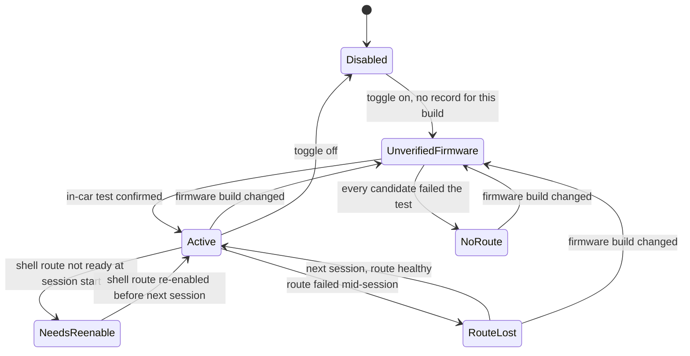
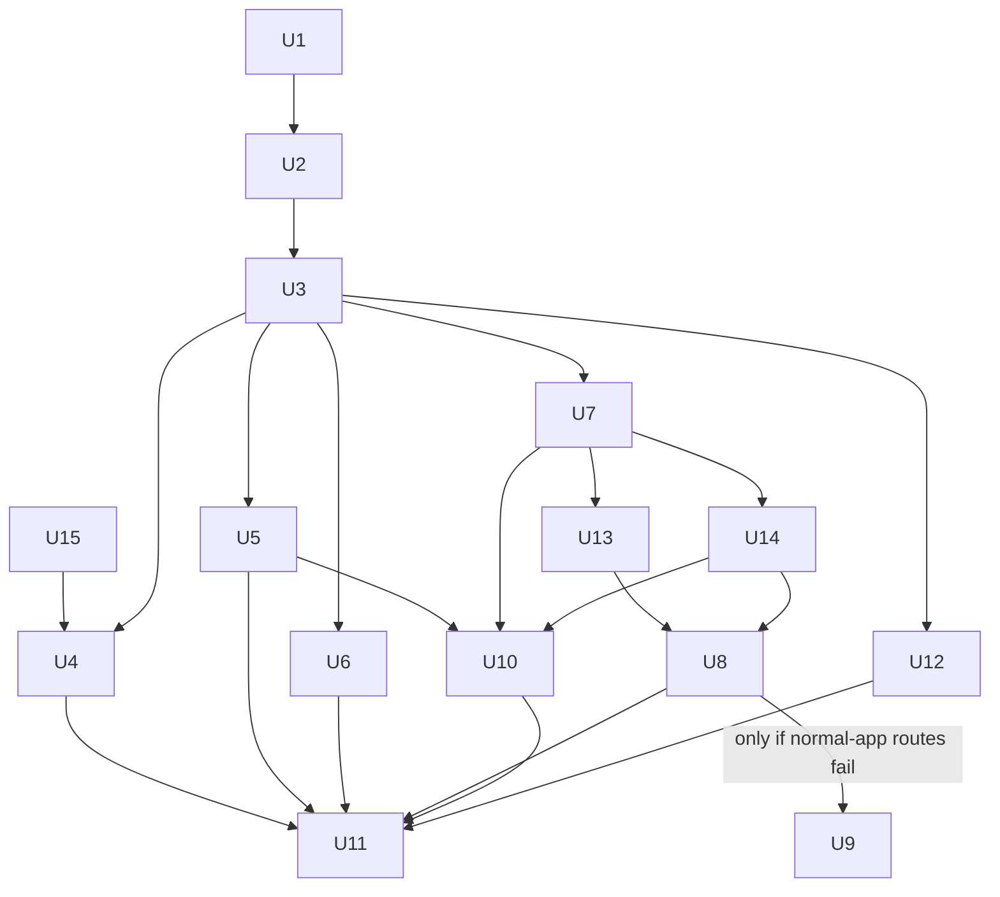

# Denza N9 Support - Plan

## Goal Capsule

- **Objective:** Make DiAuto deliver full wireless Android Auto on a China-spec Denza N9's center screen and Android Auto turn guidance on its windshield AR-HUD, without changing behavior on the tested BYD DiLink 5.1 or any other head unit beyond upstream PR #42.
- **Product authority:** The Product Contract below. The N9 owner decides product behavior. Upstream DiAuto's verified-firmware rule for HUD output constrains what is mergeable later.
- **Execution profile:** Evidence-gated. U1 and U15 are code with no car dependency; U2 is owner-run on the physical car over ADB and gates every N9-specific unit after it. Each later code unit ends with an owner on-car check recorded in `docs/N9_EVIDENCE.md`.
- **Stop conditions:** Stop and ask the owner when the probe shows the N9 blocks a prerequisite for R7 (third-party hotspot, Bluetooth start events, or background running); when any change would alter a DiLink 5.1 or generic default beyond upstream PR #42; or when every HUD route, including the shell route, fails on the car (the HUD part is then documented as not possible on this firmware).
- **Tail ownership:** The owner commits and pushes to the `AlexeiCrr/DiAutoN9` fork. Upstream contribution is follow-up work, not part of this plan.
- **Open blockers:** None.

---

## Product Contract

Product Contract preservation: changed R14 — HUD route order now follows N9 evidence (SOME/IP service first, Amap path second), user-approved at plan scoping; changed R4 — upstream PR #42 applies to every head unit, user-directed during planning. Problem Frame and Dependencies facts updated from research; Outstanding Questions resolved in place into the Planning Contract. All other R/A/F/AE IDs unchanged.

### Summary

Add Denza N9 support to DiAuto in two layers. Wireless Android Auto runs full-screen on the N9 center screen, hands-off. Android Auto turn guidance appears on the windshield AR-HUD. An ADB probe of the car comes first, and every N9-specific behavior lives in a detected N9 profile that leaves other head units untouched.

### Problem Frame

The owner drives a China-spec Denza N9 (DiLink 150 cockpit with the 6.0 UI, MediaTek mt8673-based BYD 9000 chip, 17.3" 2560x1600 center screen, 13.2" cluster, 50" AR-HUD). The car has no factory Android Auto or CarPlay. Google Maps and Waze are sideloaded onto the head unit and work, but every destination change means typing on the car's on-screen keyboard. There is no assistant, phone media, or messaging integration, and the factory AR-HUD only shows the factory Amap navigation, so Google Maps or Waze guidance never reaches the windshield.

DiAuto already delivers Android Auto on BYD head units, but it is verified only on DiLink 5.1 / Android 13 with a 1920x1080 panel, and it hard-codes that unit in several places. Another N9 owner reports that DiAuto 0.3.11 requests 1440p over H.264 on the N9's 2560x1600 panel and the connection drops about three seconds after video starts. The windshield HUD output is gated on one exact DiLink 5.1 firmware fingerprint, so on the N9 it switches itself off silently. The music-routing and renderer defaults key on `Build.MODEL == "DiLink5.1"`, a string other DiLink 150 cars also report. No BYD steering-wheel buttons are handled, and the hotspot interface detection is a guessed name list.

### Actors

- A1. N9 owner and driver: has ADB and APK-install access to the head unit, no root, and builds DiAuto from this fork.
- A2. Android phone: runs Android Auto and Google Maps/Waze, and is paired to the car once.
- A3. N9 head unit: runs DiAuto and exposes the center screen, car microphone, steering-wheel buttons, hotspot or Wi-Fi Direct, and vendor navigation services.
- A4. Windshield AR-HUD and instrument cluster: render turn guidance from whatever source the N9 firmware accepts.
- A5. Upstream DiAuto users on DiLink 5.1 and other head units: must see no change beyond upstream PR #42.

### Key Decisions

- **Full Android Auto, not a destination handoff.** The owner wants assistant, media, and messaging on the big screen, not only phone-side destination entry. (session-settled: user-directed — chosen over sending destinations from the phone to the car's own Google Maps/Waze: the "good stuff that comes with Android Auto" is the goal.) Governs R7-R12.
- **Center screen and HUD in one plan.** (session-settled: user-directed — chosen over planning center-screen Android Auto first with HUD as a follow-on brainstorm: owner accepted the larger, riskier scope.) Governs R13-R17.
- **For this N9 now, mergeable upstream later.** (session-settled: user-directed — chosen over a personal-only build hard-targeting this car, and over a separately published N9 release: keeps the door open to contribute "Denza N9 / DiLink 150 support".) Governs R4-R6, R17.
- **Probe first, then a detected N9 profile.** (session-settled: user-approved — chosen over installing upstream unchanged and patching failures one by one: with ADB available, one probe replaces guessing and keeps N9 rules out of scattered model checks.) Governs R1-R5.
- **Take upstream PR #42 now for every head unit.** Its fixes for 1440p requested over H.264 and for an 800x480 fallback after a surface change apply to all units ahead of the upstream merge. (session-settled: user-directed — chosen over an N9-only rule that waits for upstream to merge PR #42: the fix is upstream's own and helps the N9 immediately.) Governs R4, R9.
- **Least-privilege HUD ladder ordered by N9 evidence.** Normal-app routes come before any shell-privileged route, and among them the SOME/IP HUD service comes first because another N9 owner's app reached the windshield through it. (session-settled: user-approved — chosen over starting with the Amap guidance path: on DiLink 150 the Amap service may be absent and never reached the windshield on DiLink 3.) Governs R14.
- **Shell-privileged HUD route acceptable as opt-in.** (session-settled: user-directed — chosen over app-only routes and over "only if fully hands-off": HUD guidance is worth a re-enable step after car restarts.) Governs R15.
- **Windshield AR-HUD is the primary surface; the cluster is a bonus.** (session-settled: user-directed — chosen over cluster-first, both-required, and whichever-works-first.) Governs R13.
- **HUD guidance only during Android Auto sessions.** The car's own Google Maps/Waze is used only when opened on purpose. (session-settled: user-directed — chosen over HUD support for the native apps as well.) Governs R13.
- **HUD content is turn arrow, distance, and street name.** Android Auto sends no road geometry, so the AR-HUD's 3D road overlays are unreachable; coarse lane directions exist in the data but are deferred. Governs R13.
- **1440p only over a codec verified on the car.** Upstream requests 1440p over H.264 when the chip is not on its HEVC allow-list, and on the N9 that drops the connection. (session-settled: user-approved — chosen over always requesting the panel's maximum resolution: a full-screen 1080p picture beats a failed connection.) Governs R9.
- **"Hands-off" covers the Android Auto connection, not a shell-privileged HUD.** (session-settled: user-approved — chosen over requiring the HUD to be equally hands-off: the Shizuku-style route may need a re-enable after restarts.) Governs R7, R15.
- **HUD stays off on unverified firmware and says why.** (session-settled: user-approved — chosen over trying the last-known route on any firmware: matches upstream's verified-firmware rule, and a car software update should not silently send undefined data to the windshield.) Governs R17.
- **Re-verification through an in-car test plus a code list.** After a car update the owner taps a HUD test in the car and confirms the arrow appeared; known-good builds also go into a code list for upstream. (session-settled: user-directed — chosen over in-car confirmation only and over code list plus rebuild only: no rebuild after each update, while upstream keeps a reviewed list.) Governs R17.

### Requirements

**N9 probe and evidence**

- R1. A repeatable probe captures what the app currently assumes about the head unit: firmware fingerprint and model strings, chip and hardware HEVC decoders, panel resolution, refresh rate, density, and any hidden window strip, hotspot and Wi-Fi Direct interfaces and bands, the presence and versions of the vendor navigation services (Amap service, cluster receiver, SOME/IP service, car property service), steering-wheel button events, and car-microphone access for third-party apps.
- R2. The probe runs with the owner's existing ADB access and no root, and its report omits credentials and network addresses.
- R3. Each N9-specific behavior traces to probe evidence or an on-car test recorded with the project.

**N9 profile and upstream safety**

- R4. N9-specific behavior activates only when the app detects an N9 head unit; on every other head unit, including the tested DiLink 5.1, behavior and defaults stay as they are in 0.3.11 with upstream PR #42 applied.
- R5. Each N9 default (resolution, density, renderer, audio routing, fullscreen handling, button mapping, HUD route) stays overridable in settings, and a profile default never replaces an explicit user choice.
- R6. Existing automated tests keep passing, and each new N9 rule has its own tests.

**Center-screen Android Auto**

- R7. With the phone paired once, starting the car brings Android Auto up on the center screen wirelessly within about 30 seconds without touching the phone or the car, and it comes back on its own after a mid-drive link drop.
- R8. Android Auto fills the whole 17.3" panel with no black bars or dead strips, and touches land where tapped across the entire screen, edges included.
- R9. The N9 requests 1440p only with a codec confirmed working on the car, and otherwise uses full-screen 1080p.
- R10. Steering-wheel next, previous, and play/pause control Android Auto media, and the voice button starts the Google Assistant when the N9 delivers that button to apps.
- R11. Assistant voice input and calls use the car's microphone, so destinations can be set by voice.
- R12. Navigation prompts, assistant, and media play through the car speakers without Android Auto and the car's Bluetooth player fighting over audio focus.

**Windshield HUD guidance**

- R13. During an Android Auto route, the windshield AR-HUD shows the next maneuver arrow, the distance to it, and the street name, updating as the drive progresses; the cluster showing the same is a bonus, not a gate.
- R14. HUD routes are tried in order of least privilege — the car's SOME/IP HUD service, then the car's Amap guidance path, then upstream's remaining BYD receivers, then the N9's own HUD service through a shell-privileged route — and a route counts as working only after on-car confirmation that guidance renders.
- R15. A shell-privileged (Shizuku-style) HUD route, if it is the only one that works, is opt-in, and the app tells the driver when it needs re-enabling instead of failing silently.
- R16. HUD guidance clears when the route ends, when Android Auto disconnects, and when guidance goes stale, and leftover guidance after a force-stop clears on the next app open.
- R17. N9 HUD output runs only on N9 firmware that has been verified; on unverified firmware the HUD stays off and the app shows why and how to re-verify.

### Key Flows

- F1. First-time N9 setup
  - **Trigger:** Owner installs the N9-capable build for the first time.
  - **Actors:** A1, A2, A3
  - **Steps:** Owner runs the probe over ADB and reviews the report. Owner installs the build. The app detects the N9 and applies the N9 profile. Owner works through the hands-off readiness checklist and pairs the phone once over the transport the probe showed works. Owner turns on BYD navigation and runs the HUD test while parked. If only the shell route works, owner opts in and enables it.
  - **Outcome:** The next car start connects hands-off.
  - **Covered by:** R1, R2, R4, R5, R7, R14, R15
- F2. Daily drive
  - **Trigger:** Owner starts the car with the phone in a pocket.
  - **Actors:** A1, A2, A3, A4
  - **Steps:** DiAuto starts and the phone joins. Android Auto fills the center screen. Owner sets a destination by voice or on the phone. Turn guidance appears on the windshield HUD and updates per maneuver. Owner arrives and the HUD clears.
  - **Outcome:** No typing on the car screen; guidance in the driver's line of sight.
  - **Covered by:** R7-R13, R16
- F3. After a car software update
  - **Trigger:** The N9 installs an update that changes the firmware build.
  - **Actors:** A1, A3, A4
  - **Steps:** Android Auto still connects under the N9 profile. HUD output stays off and the app shows that the firmware is unverified. Owner runs the HUD test while parked and confirms the arrow appeared, and the new build becomes verified on this car. Owner re-runs the probe when the test fails.
  - **Outcome:** The HUD never sends guidance to an unverified firmware, and the driver knows why it is off.
  - **Covered by:** R1, R3, R14, R17

### Acceptance Examples

- AE1. **Covers R4.** Given a DiLink 5.1 car on the tested firmware, when it updates to the N9-capable build, then music routing, renderer, fullscreen handling, and HUD output behave exactly as in 0.3.11.
- AE2. **Covers R9.** Given an N9 where HEVC has not been confirmed working, when Android Auto connects, then the phone is asked for 1080p, the picture fills the screen, and 1440p over H.264 is never requested.
- AE3. **Covers R5.** Given the owner manually set the resolution to 1080p, when the N9 profile activates, then 1080p is kept.
- AE4. **Covers R7.** Given the phone is paired and the car hotspot comes up late after start, when the hotspot becomes ready, then Android Auto appears without the owner reopening the app.
- AE5. **Covers R15.** Given the HUD works only through the shell-privileged route and the car has restarted, when an Android Auto route starts, then the app shows that HUD needs re-enabling and center-screen Android Auto is unaffected.
- AE6. **Covers R16.** Given guidance is on the windshield, when the phone disconnects mid-route, then the HUD clears within the 30-second stale-guidance window.
- AE7. **Covers R17.** Given the car updated to a firmware build that has not been verified, when an Android Auto route starts, then no HUD output is sent and the app explains the HUD is off pending re-verification.

### Scope Boundaries

**Deferred for later**

- Android Auto on the 13.2" passenger screen or the rear ceiling screen.
- HUD guidance for the car's own Google Maps/Waze apps.
- Lane-direction hints on the HUD (Android Auto sends coarse lane directions that no app code reads today).
- Instrument cluster as a required surface (bonus only, per R13).

**Outside this work**

- True AR road overlays on the AR-HUD; Android Auto provides no road geometry.
- CarPlay (covered separately by DiPlay).
- Root, firmware modification, or anything that changes the car's system partition.
- Support for other BYD or Denza models, including DiLink 150 cars on the same chip, beyond not regressing their current behavior.
- A separately published N9 release channel.

**Deferred to Follow-Up Work**

- Contributing N9 support upstream to `shihabal3amri/DiAuto`, including a note on its N9 issue #6.
- Mirroring an app to the AR-HUD display through BYD's DiShare service (reported on the Z9GT, unverified on the N9).
- Cluster casting of the map.
- Extracting the 30-second stale-guidance constant duplicated in `hud/BydHudBridge.kt` and `hud/LatestNavigationOutput.kt`, unless a unit already touches both.

### Dependencies / Assumptions

- The car is a China-spec N9 on DiLink 150 with the 6.0 UI, Android 13, and the mt8673-based BYD 9000 chip, as reported by another N9 owner; the probe confirms this car's values.
- The owner has ADB and APK-install access and no root, and runs the probe from a computer with `adb` and a POSIX shell (Git Bash on Windows).
- The phone has working Android Auto and Google services.
- Unverified on this car: the N9 lets third-party apps run the car hotspot or Wi-Fi Direct, use the car microphone, and receive steering-wheel button events.
- Unverified on this car: the AR-HUD renders guidance sent through the SOME/IP HUD service from a normal app. Another N9 owner's app did so on firmware 2605, and street names disappeared after firmware 2607.
- The driver does not run factory Amap navigation at the same time as an Android Auto route.
- A self-built APK signed with the owner's key cannot upgrade a public DiAuto install that uses the same application ID.

### Sources / Research

**Repo**

- `app/src/main/java/com/andrerinas/openheadunit/hud/BydStandaloneHudOutput.kt` — windshield output gate: exact `Build.FINGERPRINT`, package allow-list, `com.byd.clusterdebug` versionCode 10601004, system-app flag, one SHA-256 signer.
- `app/src/main/java/com/andrerinas/openheadunit/hud/BydNavigationOutputs.kt` — routes latched once per process; standalone exclusive; otherwise Amap and SOME/IP start in parallel whenever installed, with no firmware check; `start`/`update` share one lock.
- `app/src/main/java/com/andrerinas/openheadunit/hud/BydHudBridge.kt` and `hud/BydHudProtocol.kt` — SOME/IP transport: service `0x000B010A00010000`, topic `0x0004010A00018001`, synchronous binder transactions 1/4/6 under a lock, 300 ms rebind tick.
- `app/src/main/java/com/andrerinas/openheadunit/hud/BydClusterOutput.kt` — `AUTONAVI_STANDARD_BROADCAST_SEND` to `com.byd.amapservice` with `KEY_TYPE` 10001/10019.
- `app/src/main/java/com/andrerinas/openheadunit/hud/BydStandaloneSession.kt` — pending-clear journal pattern.
- `app/src/main/java/com/andrerinas/openheadunit/utils/SUExecutor.kt` and `app/src/main/aidl/com/andrerinas/openheadunit/IShizuku.aidl` — root/Shizuku shell runner returning exit codes only, untimed `waitFor`; used today only for FYT steering-key focus.
- `app/src/main/java/com/andrerinas/openheadunit/utils/HeadUnitScreenConfig.kt`, `decoder/VideoDecoder.kt`, `decoder/CodecTypeSelectionPolicy.kt`, `aap/protocol/messages/ServiceDiscoveryResponse.kt`, `utils/SystemOptimizer.kt` — HEVC presence vs reliability tests split across sites, panel ceiling, recommendations, settings hash.
- `app/src/main/java/com/andrerinas/openheadunit/main/OnboardingActivity.kt` — onboarding stores resolution, codec, renderer, orientation, and density as explicit values on first install.
- `app/src/main/java/com/andrerinas/openheadunit/utils/Settings.kt`, `utils/SettingsBackupManager.kt`, `App.kt` — model-keyed defaults, `prefs.contains` explicit-choice pattern, backup keys, ad-hoc `Settings(context)` construction, Direct Boot branch.
- `app/src/main/java/com/andrerinas/openheadunit/connection/carkey/`, `connection/CommManager.kt`, `aap/KeyDebouncePolicy.kt`, `aap/KeyCode.kt` — vendor key receiver interface, key learning and dispatch, announced key list.
- `app/src/main/java/com/andrerinas/openheadunit/utils/DiagnosticReport.kt`, `utils/DiagnosticReportRedactor.kt`, `decoder/DecoderCapabilityReport.kt`, `utils/SystemProperties.java` — diagnostics export, redaction, decoder classification, property reads.
- `app/src/main/AndroidManifest.xml` — no `allowBackup` or extraction rules, so Android backup covers every shared-preferences file.
- `docs/BYD_NAVIGATION.md`, `docs/REVIEW.md`, `docs/HOTSPOT_RECOVERY.md`, `docs/LOCALIZATION.md` — verified scope, HUD cleanup limits, validation-record style, five-language rule.

**External**

- N9 1440p failure (2560x1600 panel, link drop about 3 s after video setup, 1080p workaround): https://github.com/shihabal3amri/DiAuto/issues/6
- Upstream fix taken in U15 (AUTO picks 1080p H.264 on unverified HEVC; manual 1440p pairs with H.265; 800x480 surface-change fix; not car-validated): https://github.com/shihabal3amri/DiAuto/pull/42
- N9 (DiLink 150, 6.0 UI) windshield HUD from a normal APK over SOME/IP: https://github.com/sunlixWhyNotAvailable/byd-hud/issues/2 and https://github.com/sunlixWhyNotAvailable/byd-hud
- Leopard 5 on DiLink 150 (mt8673, `ro.product.model=DiLink5.1`, no `com.byd.amapservice`): https://github.com/sunlixWhyNotAvailable/byd-hud/issues/4
- Amap broadcast fields on DiLink 3 (`SEG_REMAIN_DIS_AUTO`, route remainders, HUD stayed blank): https://github.com/AndyShaman/BYDMate/issues/301
- Steering-wheel keys on DiLink reach only the media-session holder; voice short press goes to BYD's assistant: https://github.com/shihabal3amri/DiPlay/pull/8
- On-device ADB patterns on BYD and Shizuku non-root auto-start: https://github.com/AndyShaman/BYDMate and https://github.com/RikkaApps/Shizuku/releases
- N9 cockpit and screens: https://en.wikipedia.org/wiki/Denza_N9, https://cnevpost.com/2025/03/21/denza-launches-n9/
- DiLink 150 mapping: https://www.difans.cn/post_byd_car/528.html

---

## Planning Contract

### Key Technical Decisions

- KTD1. **The probe is a POSIX shell script run over ADB from the owner's computer, plus a redacted section in the in-app diagnostics export.** Package visibility, `dumpsys`, `getevent`, and receiver queries are unreachable from the app; the in-app section adds what only the app sees (decoder capabilities, window metrics). Implements the "probe first" Key Decision. Governs R1-R3.
- KTD2. **N9 detection reads identity properties, never `Build.MODEL` alone, and matches the N9 only.** Inputs are fingerprint family, board, hardware, and the vehicle-type and car-model properties the probe finds; other DiLink 150 cars on the same chip keep their current behavior. (session-settled: user-approved — chosen over a DiLink 150 platform-wide profile: the Leopard 5/8 share the chip and the `DiLink5.1` model string but nobody has verified the N9 rules on them.) Governs R4.
- KTD3. **The N9 profile is a pure policy over one process-wide identity holder, consulted at use time and never written to preferences.** `HeadUnitIdentity` is a lazy snapshot of `Build` values and system properties, safe before unlock, with a test override. `Settings` getters and the direct consumers listed under System-Wide Impact ask the profile only when no preference is stored. Under the N9 profile, onboarding writes the deferring values (AUTO resolution, "Auto" codec) and leaves renderer and density unset, so an applied recommendation is never mistaken for a user choice. The profile never owns auto-start defaults. Governs R4, R5.
- KTD4. **Upstream PR #42 lands first as its own untouched commit, and the N9 rule overrides it through KTD5 without editing its lines.** That keeps the fork rebasing cleanly when upstream merges PR #42. (session-settled: user-directed — chosen over an N9-only rule waiting for the upstream merge: the fix is upstream's own and helps the N9 immediately.) Governs R4, R9.
- KTD5. **Under the N9 profile, one "HEVC verified" input replaces both upstream HEVC tests (decoder presence and the SoC reliability list) wherever they decide resolution or codec.** That covers AUTO negotiation, the panel ceiling, onboarding and settings recommendations, service discovery, and the decoder's codec choice, so the announcement and the decoder never disagree. Until it is set, the N9 negotiates 1080p H.264, and PR #42's allow-list never upgrades the N9 by itself. A manual 1440p choice keeps PR #42's H.265 pairing. The flag is keyed by firmware fingerprint and feeds the cached screen-configuration hash. Governs R9.
- KTD6. **The 16:10 panel is filled through Android Auto's video margins with uniform scaling, not by stretching the 16:9 stream.** Under the N9 profile, when panel and stream aspect differ by more than 2%, the margins make the phone draw its UI at the panel's aspect and the head unit crops them. (session-settled: user-approved — chosen over stretching the picture about 11%: no distortion and no bars, at a slightly lower effective resolution.) Governs R8.
- KTD7. **An N9 hotspot interface hint, if U2 shows one is needed, enters selection as a rank hint and never as the `hotspot-interface` setting.** BYD's access point is `ap0`, which today's prefix ranking already prefers; the setting is an explicit override that waits indefinitely, so a wrong profile value would block the connection. A hint, when added, applies at every interface-name match site. Governs R7.
- KTD8. **Steering-wheel input uses only what reaches the app, plus the existing key learning.** Media keys follow the media-session path the probe shows; Google Assistant goes on the voice long press; an accessibility service that intercepts the button is added only if the long press never reaches the app, and only as an opt-in. New keys are announced to the phone only under the N9 profile. (session-settled: user-approved — chosen over taking the short press away from BYD's own assistant.) Governs R10.
- KTD9. **Under the N9 profile, HUD route selection is per Android Auto session, from connect to disconnect.** The route is chosen once, off the main thread, from SOME/IP, Amap, the `clusterdebug` receiver, and the shell route in R14 order, and each needs a verification record for the exact firmware build. A second start call in the same session is a no-op, and stop closes the route's worker and unbinds its service. Non-N9 units keep upstream's once-per-process start logic unchanged. Implements the least-privilege ladder Key Decision. Governs R13, R14, R17.
- KTD10. **A verification record is the tuple of firmware fingerprint, route, target component versionCode, system-app flag, and signer digest, drawn from the compiled list or an in-car confirmation.** Local records, the HEVC flag, and the N9 clear journal live in files under the app's no-backup directory, so neither Android backup nor settings export carries them to another car or firmware. A failed record expires when the target versionCode changes, and clearing app data drops local records. Implements the re-verification Key Decision. Governs R17.
- KTD11. **The in-car HUD test runs only while parked and outside an Android Auto session.** It sends one shared left-arrow, right-arrow, clear step list through one candidate route under the scheduler's synthetic hold, then asks a yes/no question; "yes" writes a record and "no" moves to the next candidate. The debug per-route action uses the same step list. Governs R14, R17.
- KTD12. **Every N9 route journals a pending clear keyed by firmware fingerprint and route, and replays it at app open or service start only when both still match.** A mismatched entry is discarded, so a clear never reaches unverified firmware. The DiLink 5.1 standalone journal stays untouched. Governs R16, R17.
- KTD13. **The shell route reuses the app's single `SUExecutor` from `AppComponent` and is built only if every normal-app route fails on the car.** `SUExecutor` gains a public command runner that returns output and times out, a permission request, and binder-death handling. An embedded local-ADB client (the pattern BYD community apps use) is the fallback if Shizuku cannot start on the N9. Implements the shell-route Key Decision. Governs R15.
- KTD14. **HUD and readiness status come from one pure status policy and render before the drive: home screen, settings, and a notification, never over the projection.** "Show the BYD navigation toggle" and "a route is available" become separate checks, so on the N9 the toggle stays visible with its reason instead of hiding. Governs R15, R17.
- KTD15. **HUD route work is isolated from the projection.** Session start, updates, stop, journal replay, and the in-car test only hand work to a per-route worker; no binder call, shell command, package lookup, or disk commit runs on the main thread or under the outputs lock. Every route call has a timeout, and the route boundary catches every throwable. After a short backed-off retry, a failing route is marked lost for the session: it attempts a clear, keeps its journal entry, publishes status, and does not fall through to the next route until the next session. Governs R13, R16, R17.
- KTD16. **HEVC is verified by a one-shot 1440p trial started from settings under the N9 profile.** The next session negotiates 1440p H.265; 60 seconds of stable video marks HEVC verified for this firmware build, and an earlier drop marks it failed and returns to 1080p H.264. Governs R9.

### High-Level Technical Design

The N9 profile is one decision point over a process-wide identity holder. It feeds `Settings` getters and a short list of direct consumers; stored user choices override it at each getter.

HUD route selection under the N9 profile, per R14 and KTD9. It runs once per Android Auto session, off the main thread. The non-N9 branch is upstream's current behavior.

HUD status on the N9, which drives the status surface in KTD14.

Unit dependencies. U2 is the owner-run evidence gate; U9 runs only when U8's normal-app routes fail on the car.

### Assumptions

- The N9 identity values reported by another owner (`mt8673`, board `spm8673p1_64`, 2560x1600) match this car; U2 confirms or replaces them before any rule uses them.
- Upstream's SOME/IP bridge payload is close to what the byd-hud app sends on the N9; U8 adjusts fields from on-car results.
- PR #42 applies cleanly on 0.3.11; if upstream amends it before merging, U15 is re-taken from the merged version.

### Deferred to Implementation

- Which wireless transport (car hotspot or Wi-Fi Direct) the N9 profile defaults to, from U2 evidence.
- Whether media audio goes through Android Auto or the car's Bluetooth on the N9, from the U2 baseline drive.
- The N9 density default for the 17.3" panel, chosen during the U12 on-car check.
- Whether the N9 clamps the window like DiLink 5.1, which decides whether the fullscreen fix needs an N9 guard.
- The N9-specific identity signal (vehicle type or car-model property) that separates the N9 from other DiLink 150 cars.
- Whether Shizuku starts on the N9 without a computer, which decides between Shizuku and the local-ADB fallback in U9.
- Whether `HeadUnitScreenConfig.recalculate` already produces KTD6-style margins for panels above 1080p, found by U12's characterization tests.

### Risks & Dependencies

| Risk | Mitigation |
|---|---|
| A HUD binder or shell call hangs and freezes projection; the SOME/IP bridge transacts synchronously under a lock today. | KTD15 worker isolation, timeouts, and throwable boundary; U7 tests a hung transport. |
| A car update changes HUD behavior (street names vanished after N9 firmware 2607 for another owner). | Verification is per firmware build (KTD10); the HUD stays off until the in-car test passes again. |
| Android backup or settings import carries HUD records to another car or firmware. | KTD10 no-backup storage; KTD12 fingerprint-matched replay. |
| PR #42 changes before upstream merges it. | U15 stays an untouched commit; KTD5 isolates the N9 rule behind one input. |
| The N9 reports `DiLink5.1` and silently inherits DiLink 5.1 defaults today. | KTD2 detection; U3 tests prove DiLink 5.1 and Leopard-like identities keep current defaults. |
| A process started before unlock never sees the profile. | KTD3 identity holder reads `Build` and system properties lazily, without `Settings`. |
| BYD's "disable background apps" or quick-boot kills DiAuto before the phone joins. | U5 readiness checklist shows it as a manual check; the probe records the setting. |
| Wheel buttons reach only accessibility services or BYD's assistant. | KTD8 limits scope to delivered keys; the accessibility service stays opt-in. |
| A HUD test while driving distracts the driver. | KTD11 allows the test only while parked and outside a session. |
| Self-built APK conflicts with a public DiAuto install (same application ID). | Owner uninstalls the public build first and keeps one signing key; documented in U11. |

### System-Wide Impact

- **Profile consumers outside `Settings`:** video negotiation (`HeadUnitScreenConfig`, `SystemOptimizer`, `ServiceDiscoveryResponse`, `CodecTypeSelectionPolicy`), HUD route selection (`BydNavigationOutputs`), announced keys and microphone format (`KeyCode.supported`, `ServiceDiscoveryResponse`), the fullscreen guard (`BydFullscreen`), and, only if U2 requires them, `BootLoopPolicy` and hotspot ranking. Each consumer has a test proving non-N9 identities see no change.
- **Upstream PR #42:** changes resolution and codec choice on every head unit, by the owner's decision; everything else stays at 0.3.11 for non-N9 units.
- **Settings and onboarding:** fresh N9 installs store deferring values for profile-owned settings; DiLink 5.1 and generic units keep current onboarding, defaults, and backup contents.
- **Threading:** `AapService` delivers session events on the main thread; KTD15 keeps every HUD route operation off it.
- **Backup and data:** new HUD records, the HEVC flag, and the N9 clear journal sit in the no-backup directory; existing shared preferences, including the standalone journal, keep today's backup behavior.
- **Localization and CI:** every new string ships in en, ar, es, ru, and zh-rCN, or `scripts/check_localization.py` fails both CI jobs.
- **Safety:** the HUD test and every status message stay off the projection surface while driving.

---

## Implementation Units

| U-ID | Title | Key files | Depends on |
|---|---|---|---|
| U1 | N9 probe tooling and identity snapshot | `scripts/n9_probe.sh`, `profile/HeadUnitIdentity.kt`, `hud/HudTestSteps.kt` | — |
| U2 | Owner probe run and baseline drive | `docs/N9_EVIDENCE.md` | U1 |
| U3 | N9 profile and read-time defaults | `profile/HeadUnitProfilePolicy.kt`, `utils/Settings.kt`, `main/OnboardingActivity.kt` | U2 |
| U4 | Video negotiation under the N9 profile | `decoder/VideoNegotiationPolicy.kt`, `utils/HeadUnitScreenConfig.kt`, `aap/protocol/messages/ServiceDiscoveryResponse.kt` | U3, U15 |
| U5 | Hands-off wireless connection | `main/HandsOffReadinessPolicy.kt`, `main/ConnectionSetupFragment.kt` | U3 |
| U6 | Steering keys, voice, mic and audio | `aap/VoiceKeyPolicy.kt`, `connection/CommManager.kt`, `aap/KeyCode.kt` | U3 |
| U7 | N9 HUD session route and verification records | `hud/HudRoutePolicy.kt`, `hud/N9HudSession.kt`, `hud/HudVerificationStore.kt` | U3 |
| U8 | SOME/IP and Amap payload adaptation | `hud/BydHudBridge.kt`, `hud/BydHudPayload.kt`, `hud/BydClusterOutput.kt` | U13, U14 |
| U9 | Shell-privileged HUD route (conditional) | `utils/SUExecutor.kt`, `hud/ShellHudOutput.kt`, `hud/ShellAccessStatePolicy.kt` | U8 |
| U10 | HUD and readiness status surface | `hud/HudStatusPolicy.kt`, `main/HomeFragment.kt`, `res/values*/strings.xml` | U5, U7, U14 |
| U11 | N9 docs and validation record | `docs/N9_SUPPORT.md`, `README.md`, `CHANGELOG.md` | U4, U5, U6, U8, U10, U12 |
| U12 | 16:10 display fit and touch | `utils/HeadUnitScreenConfig.kt`, `aap/TouchCoordinateMapper.kt`, `utils/BydFullscreen.kt` | U3 |
| U13 | N9 HUD clear journal | `hud/HudClearJournal.kt`, `hud/BydNavigationOutputs.kt` | U7 |
| U14 | In-car HUD test | `hud/HudTestSequence.kt`, `main/SettingsFragment.kt` | U7 |
| U15 | Upstream PR #42 | files as changed upstream | — |

Key-file paths are relative to `app/src/main/java/com/andrerinas/openheadunit/` unless they start with `scripts/`, `docs/`, or `res/`; unit bodies give full repo-relative paths. Suggested order: U1, U15, U2, U3, then U4/U5/U6/U12/U7 in any order, then U13, U14, U8, U9 (if needed), U10, U11.

### U1. N9 probe tooling and identity snapshot

- **Goal:** An owner-run ADB script captures the R1 evidence in one redacted report; the app gains one identity snapshot, a matching diagnostics section, and a debug per-route HUD send action so U2 can test each route.
- **Requirements:** R1, R2, R3; F1; KTD1, KTD3, KTD11.
- **Dependencies:** None.
- **Files:**
  - Create `scripts/n9_probe.sh`
  - Create `docs/N9_PROBE.md`
  - Create `app/src/main/java/com/andrerinas/openheadunit/profile/HeadUnitIdentity.kt`
  - Create `app/src/main/java/com/andrerinas/openheadunit/utils/HeadUnitProbe.kt`
  - Create `app/src/main/java/com/andrerinas/openheadunit/hud/HudTestSteps.kt`
  - Modify `app/src/main/java/com/andrerinas/openheadunit/utils/DiagnosticReport.kt`
  - Modify `app/src/main/java/com/andrerinas/openheadunit/utils/DiagnosticReportRedactor.kt`
  - Modify `app/src/debug/java/com/andrerinas/openheadunit/hud/HudStatusReceiver.kt`
  - Test `app/src/test/java/com/andrerinas/openheadunit/profile/HeadUnitIdentityTest.kt`
  - Test `app/src/test/java/com/andrerinas/openheadunit/utils/HeadUnitProbeTest.kt`
  - Test `app/src/test/java/com/andrerinas/openheadunit/utils/DiagnosticReportRedactorTest.kt`
- **Approach:**
  1. The script writes one section per evidence area: identity properties (fingerprint, model, board, hardware, platform, every `ro.*vehicle*` and DiLink property), displays and modes, window insets and freeform setting, media codecs, network interfaces and hotspot state, Bluetooth adapter and profile owners, vendor navigation packages with versionCodes and the receivers or services for `AUTONAVI_STANDARD_BROADCAST_SEND`, `byd.hud.NAVIGATION`, and the SOME/IP service, audio input devices, background-app and developer/ADB settings.
  2. A timed `getevent` and logcat window records steering-wheel buttons while the owner presses each one, with prompts in the script.
  3. Every section tolerates a missing command and prints "unavailable"; output passes a redaction filter for MAC, IP, serial, SSID, and passphrase values.
  4. `HeadUnitIdentity` reads `Build` values and properties through `utils/SystemProperties.java` behind an injected reader, is lazy and process-wide, and has a test override.
  5. `HeadUnitProbe` renders identity, display metrics, interface names, and decoders from `DecoderCapabilityReport.query`, with pure rendering split from the Context reader; versionCodes print as integers so the IP mask cannot eat four-part version names.
  6. `HudTestSteps` defines the left 500 m, right 800 m, clear step list once; the debug receiver gains a per-route send action (SOME/IP, Amap, `clusterdebug`) that uses it, reachable only from an ADB shell like the existing actions.
- **Patterns to follow:** `scripts/install.sh` for shell style; `aap/ExternalBtPolicy.kt` for an injected property reader; `decoder/DecoderCapabilityReport.kt` and its test for pure rendering; existing `HUD_SEND_TEST` handling in the debug receiver.
- **Test scenarios:**
  - An identity built from an injected reader exposes fingerprint, model, board, hardware, platform, and vehicle type.
  - A reader that throws or returns blanks yields "unknown" fields without throwing.
  - A decoder list containing `c2.mtk.hevc.decoder` marked hardware renders as a hardware HEVC line.
  - Display metrics of 2560x1600 at 60 Hz render width, height, refresh, and aspect.
  - The redactor keeps `versionCode=10601004` and a vendor package name intact, still masks IPv4, IPv6, and MAC addresses, and drops a line containing a hotspot passphrase.
  - The shared step list is left 500 m, right 800 m, then clear.
  - Script smoke: running against any adb-connected Android device produces every section header and exits zero when a section's command is missing.
- **Verification:** A run against an emulator or phone yields a complete report with no MAC, IP, or SSID values; the in-app export shows the new section; the debug per-route action sends the step list through a chosen route.

### U2. Owner probe run and baseline drive

- **Goal:** Capture the N9 evidence and the behavior of the unmodified build on the car, and commit it as the baseline every N9 rule cites.
- **Requirements:** R1, R3; F1. Gates U3-U14.
- **Dependencies:** U1.
- **Files:**
  - Create `docs/N9_EVIDENCE.md`
  - Create `docs/n9/probe-<firmware-build>.txt`
- **Approach:**
  1. Owner runs `scripts/n9_probe.sh` with the car parked and commits the redacted report.
  2. Owner installs the current fork build (U1 plus U15 when available), sets Resolution to 1080p, grants Nearby devices, and enters hotspot details per `docs/CONNECTION_SETUP.md`.
  3. On drives, owner records: car-start-to-projection time over several starts; picture fit and bars on the 16:10 panel; touch accuracy at all four edges; what each wheel button does; voice short and long press; assistant through the car mic; a phone call; whether media audio pauses or fights.
  4. Owner turns on BYD navigation if the toggle shows, navigates with Google Maps in Android Auto, and records what the windshield and cluster show.
  5. Owner installs the debug build (`.bydhudtest` suffix) and triggers U1's per-route send action over ADB for each available route, recording what the windshield and cluster show.
  6. Owner notes which identity property separates this N9 from other DiLink 150 cars.
- **Execution note:** Owner-run on the physical car; an agent cannot perform this unit. Its results decide the conditional work in U5, U6, U8, U9, and U12.
- **Test expectation:** none -- evidence capture, no code.
- **Verification:** `docs/N9_EVIDENCE.md` answers every item in steps 3-6, links the probe report, and lists anything the probe could not capture.

### U3. N9 profile and read-time defaults

- **Goal:** A pure policy recognizes the N9 from the identity snapshot and supplies N9 defaults whenever no user choice is stored; onboarding on the N9 stops freezing profile-owned settings.
- **Requirements:** R4, R5, R6; AE1, AE3; KTD2, KTD3.
- **Dependencies:** U2.
- **Files:**
  - Create `app/src/main/java/com/andrerinas/openheadunit/profile/HeadUnitProfilePolicy.kt`
  - Modify `app/src/main/java/com/andrerinas/openheadunit/utils/Settings.kt`
  - Modify `app/src/main/java/com/andrerinas/openheadunit/view/ProjectionRendererPolicy.kt`
  - Modify `app/src/main/java/com/andrerinas/openheadunit/main/OnboardingActivity.kt`
  - Test `app/src/test/java/com/andrerinas/openheadunit/profile/HeadUnitProfilePolicyTest.kt`
  - Test `app/src/test/java/com/andrerinas/openheadunit/view/ProjectionRendererPolicyTest.kt`
- **Approach:**
  1. The policy takes a `HeadUnitIdentity` and returns N9 or "existing behavior"; the N9 match requires the N9-specific signal from U2 and never relies on the model string.
  2. "Existing behavior" leaves today's model-keyed defaults exactly as they are, including the case-sensitivity difference between the two existing checks.
  3. Getters for renderer, music routing, resolution, codec, density, media-key routing, and HUD route consult the policy only when `prefs.contains` is false; nothing is written.
  4. Under the N9 profile, onboarding writes AUTO resolution and "Auto" codec and leaves renderer and density unset; on every other identity onboarding is unchanged.
  5. Auto-start settings stay outside the profile.
- **Patterns to follow:** `view/ProjectionRendererPolicy.kt` and its test; the `prefs.contains` explicit-choice pattern in `utils/Settings.kt`.
- **Test scenarios:**
  - An N9 identity from U2 evidence resolves to the N9 profile.
  - A DiLink 5.1 identity on the tested firmware resolves to existing behavior, and every owned default equals 0.3.11. Covers AE1.
  - A Leopard-like identity (DiLink 150 vehicle type, `DiLink5.1` model, mt8673, no N9 signal) keeps the defaults it gets today.
  - A generic tablet identity keeps today's defaults.
  - For each owned setting on an N9 identity: unset returns the N9 default, and an explicitly stored value returns the stored value even when it equals the stored-zero default (AUTO resolution, ALWAYS key routing). Covers AE3.
  - After settings reset on an N9, the N9 default returns and no preference key exists for it.
  - N9 onboarding stores AUTO and "Auto" and no renderer or density; DiLink 5.1 onboarding stores what it stores today.
  - The identity holder answers before any `Settings` instance exists, as in a Direct Boot start.
- **Verification:** Existing `ProjectionRendererPolicyTest` cases pass unchanged and the new policy tests pass.

### U4. Video negotiation under the N9 profile

- **Goal:** The N9 negotiates 1080p H.264 until HEVC is verified on the car, then 1440p H.265, with every resolution and codec site agreeing.
- **Requirements:** R5, R9; AE2, AE3; KTD4, KTD5, KTD16.
- **Dependencies:** U3, U15.
- **Files:**
  - Create `app/src/main/java/com/andrerinas/openheadunit/decoder/VideoNegotiationPolicy.kt`
  - Create `app/src/main/java/com/andrerinas/openheadunit/decoder/HevcVerificationStore.kt`
  - Modify `app/src/main/java/com/andrerinas/openheadunit/utils/HeadUnitScreenConfig.kt`
  - Modify `app/src/main/java/com/andrerinas/openheadunit/utils/SystemOptimizer.kt`
  - Modify `app/src/main/java/com/andrerinas/openheadunit/aap/protocol/messages/ServiceDiscoveryResponse.kt`
  - Modify `app/src/main/java/com/andrerinas/openheadunit/decoder/CodecTypeSelectionPolicy.kt`
  - Modify `app/src/main/java/com/andrerinas/openheadunit/main/SettingsFragment.kt` (1440p trial entry)
  - Modify `app/src/main/res/values/strings.xml` and the `values-ar`, `values-es`, `values-ru`, `values-zh-rCN` copies
  - Test `app/src/test/java/com/andrerinas/openheadunit/decoder/VideoNegotiationPolicyTest.kt`
  - Test `app/src/test/java/com/andrerinas/openheadunit/decoder/HevcVerificationStoreTest.kt`
  - Test `app/src/test/java/com/andrerinas/openheadunit/decoder/CodecTypeSelectionPolicyTest.kt`
- **Approach:**
  1. `VideoNegotiationPolicy` supplies only the HEVC gate and codec decision; it keeps `SystemOptimizer.panelCeiling`'s resolution buckets and takes the SDK level as a parameter.
  2. Under the N9 profile, the gate is the KTD5 "HEVC verified" flag; elsewhere it returns PR #42's existing decision, so non-N9 units keep U15 behavior.
  3. Route the gate into AUTO negotiation, the panel ceiling, the recommendation sites, service discovery, and `CodecTypeSelectionPolicy`'s HEVC-usable input.
  4. Add the profile and the flag to `HeadUnitScreenConfig`'s settings hash so cached surface dimensions refresh when the flag flips.
  5. The 1440p trial (KTD16) writes the flag per firmware fingerprint in the no-backup directory.
- **Patterns to follow:** `decoder/DecoderConfigLadder.kt` for SDK-as-parameter policies; `decoder/CodecTypeSelectionPolicy.kt` and its test.
- **Test scenarios:**
  - N9, 2560x1600, hardware HEVC present, not verified, AUTO: negotiates 1920x1080 H.264. Covers AE2.
  - N9, HEVC verified for this fingerprint, AUTO: negotiates 2560x1440 H.265.
  - N9, HEVC verified for a different fingerprint: treated as not verified.
  - N9, stored 1080p: stays 1080p. Covers AE3.
  - N9, stored 1440p with hardware HEVC: pairs 1440p with H.265, never H.264.
  - N9, SoC on PR #42's reliability list but flag unset: still 1080p H.264.
  - DiLink 5.1, 1920x1080, AUTO: same result as U15 alone.
  - Generic 2560x1440 tablet: same result as U15 alone.
  - The announced codec and the decoder's codec choice agree for every case above.
  - The settings hash changes when the flag flips.
  - Trial: 60 seconds of video sets verified; a drop at 3 seconds sets failed and the next session negotiates 1080p H.264.
- **Verification:** Unit tests pass; on the car, the default connection survives past video setup at 1080p, and the 1440p trial either verifies or falls back cleanly.

### U5. Hands-off wireless connection

- **Goal:** Starting the car brings Android Auto up within about 30 seconds without a touch, and the setup screen shows what still blocks hands-off start.
- **Requirements:** R7; AE4; F1, F2; KTD7.
- **Dependencies:** U3.
- **Files:**
  - Create `app/src/main/java/com/andrerinas/openheadunit/main/HandsOffReadinessPolicy.kt`
  - Modify `app/src/main/java/com/andrerinas/openheadunit/main/ConnectionSetupFragment.kt`
  - Modify `app/src/main/res/values/strings.xml` and the `values-ar`, `values-es`, `values-ru`, `values-zh-rCN` copies
  - Modify (only if U2 requires) `app/src/main/java/com/andrerinas/openheadunit/aap/SoftApNetworkPolicy.kt`, `aap/LocalHotspotPolicy.kt`, `connection/LegacyHotspotRadio.kt`
  - Modify (only if U2 requires) `app/src/main/java/com/andrerinas/openheadunit/aap/BootLoopPolicy.kt`
  - Test `app/src/test/java/com/andrerinas/openheadunit/main/HandsOffReadinessPolicyTest.kt`
  - Test `app/src/test/java/com/andrerinas/openheadunit/aap/SoftApNetworkPolicyTest.kt`
  - Test `app/src/test/java/com/andrerinas/openheadunit/aap/BootLoopPolicyTest.kt`
- **Approach:**
  1. `HandsOffReadinessPolicy` takes booleans built from `AppPermissions` ids (overlay, Nearby devices), battery exemption, and the auto-enable-hotspot setting, and returns each item as satisfied, missing, or manual-check; BYD's background-app setting is always manual-check because an app cannot read it.
  2. The connection setup screen lists the items with their state, next to the existing write-settings and auto-hotspot checks.
  3. Add an interface hint only if U2 shows the N9 access point is not already ranked first, and apply it at all three interface-name match sites (KTD7).
  4. Change `BootLoopPolicy` only if U2 shows car wake cycles trip it, and only under the N9 profile through the identity holder.
- **Patterns to follow:** `utils/AppPermissions.kt` ids and `isGranted`; `aap/PlaybackFocusPolicy.kt` for pure-policy enums.
- **Test scenarios:**
  - Overlay permission missing: not ready, overlay item missing.
  - Every checkable prerequisite met: ready, with the background-app item still manual-check.
  - Battery exemption missing: item missing with its action.
  - With a hint: candidates `eth0`, station `wlan0`, and the N9 access point choose the access point. Without a hint: today's choice.
  - A hint naming an absent interface falls back to today's ranking without waiting.
  - `BootLoopPolicy` on a non-N9 identity: behavior unchanged.
- **Verification:** Unit tests pass; on the car, five consecutive starts reach Android Auto within about 30 seconds untouched, a late hotspot recovers (AE4), and toggling phone Wi-Fi mid-drive recovers.

### U6. Steering keys, voice, mic and audio

- **Goal:** Wheel next, previous, and play/pause control Android Auto media; the voice long press starts Google Assistant through the car mic; media audio does not fight the car's Bluetooth player.
- **Requirements:** R10, R11, R12; KTD8.
- **Dependencies:** U3.
- **Files:**
  - Create `app/src/main/java/com/andrerinas/openheadunit/aap/VoiceKeyPolicy.kt`
  - Modify `app/src/main/java/com/andrerinas/openheadunit/aap/KeyCode.kt`
  - Modify `app/src/main/java/com/andrerinas/openheadunit/aap/KeyDebouncePolicy.kt`
  - Modify `app/src/main/java/com/andrerinas/openheadunit/connection/CommManager.kt`
  - Modify `app/src/main/java/com/andrerinas/openheadunit/aap/MediaKeyRoutingPolicy.kt`
  - Modify `app/src/main/java/com/andrerinas/openheadunit/aap/AapMediaPlayback.kt` (only if media keys reach media-session holders only)
  - Modify `app/src/main/java/com/andrerinas/openheadunit/utils/Settings.kt`
  - Modify `app/src/main/java/com/andrerinas/openheadunit/decoder/MicRecorder.kt`
  - Modify `app/src/main/java/com/andrerinas/openheadunit/aap/protocol/messages/ServiceDiscoveryResponse.kt`
  - Create (conditional) `app/src/main/java/com/andrerinas/openheadunit/connection/carkey/byd/BydAccessibilityKeyService.kt`, its accessibility config XML, and strings in all five languages
  - Test `app/src/test/java/com/andrerinas/openheadunit/aap/VoiceKeyPolicyTest.kt`
  - Test `app/src/test/java/com/andrerinas/openheadunit/aap/KeyDebouncePolicyTest.kt`
  - Test `app/src/test/java/com/andrerinas/openheadunit/aap/MediaKeyRoutingPolicyTest.kt`
  - Test `app/src/test/java/com/andrerinas/openheadunit/aap/ProjectionKeyPolicyTest.kt`
- **Approach:**
  1. From U2, classify each wheel button as a key event to the focused window, media-session-only, or captured by BYD.
  2. `VoiceKeyPolicy` turns the voice long press into Android Auto's assistant key, reusing `KeyDebouncePolicy`'s down-time state; the hook is `CommManager.sendKey`; the short press stays with BYD's assistant.
  3. Announce any new key to the phone only under the N9 profile.
  4. If media keys reach only media-session holders, keep DiAuto's session active while Android Auto media plays; in music-through-car-Bluetooth mode the phone already receives them over AVRCP.
  5. Add the accessibility service only if U2 shows the long press never reaches the app, as an opt-in with its own explanation.
  6. Under the N9 profile, declare the microphone format from the recorder's sample rate; other units keep the fixed 16 kHz declaration.
  7. Set the N9 music-routing default from the U2 baseline.
- **Patterns to follow:** `connection/carkey/fyt/CarFYTReceiver.kt` for a vendor key path; `aap/KeyDebouncePolicy.kt` and `aap/MediaKeyRoutingPolicy.kt` with their tests.
- **Test scenarios:**
  - The N9 voice long-press keycode produces Android Auto's assistant key.
  - The voice short press is not consumed by DiAuto.
  - An unmapped proprietary keycode above 1000 is dropped unless learned.
  - The announced key list is unchanged on non-N9 identities and includes the assistant key on the N9.
  - The N9 media-key routing default produces one track change per press when the car's Bluetooth also handles the key.
  - Under the N9 profile, the declared microphone sample rate equals the recorder rate for every allowed setting; non-N9 identities still declare 16 kHz.
  - The music-routing default is the N9 value on the N9 and unchanged on DiLink 5.1.
- **Verification:** Unit tests pass; on the car, each media button press changes exactly one thing, the voice long press opens Assistant and "navigate to" works, a call during navigation uses the car audio, and media does not pause in a loop.

### U7. N9 HUD session route and verification records

- **Goal:** Under the N9 profile, each Android Auto session runs at most one verified HUD route, chosen off the main thread and isolated from the projection; other head units keep upstream behavior.
- **Requirements:** R13, R14, R17; AE1, AE7; KTD9, KTD10, KTD15.
- **Dependencies:** U3.
- **Files:**
  - Create `app/src/main/java/com/andrerinas/openheadunit/hud/HudRoutePolicy.kt`
  - Create `app/src/main/java/com/andrerinas/openheadunit/hud/N9HudSession.kt`
  - Create `app/src/main/java/com/andrerinas/openheadunit/hud/HudVerificationStore.kt`
  - Create `app/src/main/java/com/andrerinas/openheadunit/hud/VerifiedHudBuilds.kt`
  - Modify `app/src/main/java/com/andrerinas/openheadunit/hud/BydNavigationOutputs.kt`
  - Modify `app/src/main/java/com/andrerinas/openheadunit/main/SettingsFragment.kt` (toggle visibility check)
  - Modify `app/src/main/AndroidManifest.xml` (`<queries>` for any N9 package U2 finds)
  - Test `app/src/test/java/com/andrerinas/openheadunit/hud/HudRoutePolicyTest.kt`
  - Test `app/src/test/java/com/andrerinas/openheadunit/hud/HudVerificationStoreTest.kt`
  - Test `app/src/test/java/com/andrerinas/openheadunit/hud/N9HudSessionTest.kt`
- **Approach:**
  1. `HudRoutePolicy` takes the profile, the available routes, and the records, and returns one route or a reason for none.
  2. `HudVerificationStore` keeps a pure core with injected persistence over a file in the no-backup directory; `VerifiedHudBuilds` holds the compiled list and references the existing DiLink 5.1 constants instead of copying the fingerprint.
  3. `N9HudSession` is created at session start, resolves availability and records on its worker, sends through the chosen route with timeouts and a throwable boundary, and on stop closes the worker and unbinds (KTD15).
  4. `BydNavigationOutputs.start` hands off to `N9HudSession` only under the N9 profile; a second start in the same session is a no-op; the once-per-process branch stays as-is for every other unit.
  5. Split "show the toggle" from "a route is available" so the N9 toggle stays visible.
- **Patterns to follow:** `hud/BydStandaloneHudOutput.kt` `available()` gate; `hud/BydStandaloneSessionTest.kt` `Rig` pattern for injected persistence.
- **Test scenarios:**
  - N9 with SOME/IP available and verified for this build: SOME/IP only.
  - N9 with SOME/IP verified on the previous build only: no route, reason "unverified firmware". Covers AE7.
  - N9 with SOME/IP unavailable and Amap verified: Amap only.
  - N9 with nothing verified and SOME/IP available: no output, SOME/IP offered as the test candidate.
  - A record whose target versionCode, system-app flag, or signer digest differs does not match.
  - A failed record expires once the target versionCode changes.
  - A corrupt or unreadable store is treated as unverified.
  - A record written between sessions activates on the next session without a process restart.
  - A second start call in the same session does not create a second route.
  - The selected route fails to bind: no output, status "route lost", and no second route in that session.
  - A transport that hangs does not delay session start, and a thrown error marks the route lost instead of stopping the scheduler.
  - After stop, no rebind or send happens.
  - DiLink 5.1 on the tested firmware: standalone route exclusive, as today. Covers AE1.
  - Generic unit with Amap and SOME/IP packages installed: both start, as today.
- **Verification:** Unit tests pass, and on the car the debug log names the selected route or the reason for none at every session start.

### U8. SOME/IP and Amap payload adaptation

- **Goal:** Android Auto guidance renders on the N9 windshield through the first working normal-app route, with fields matching what this firmware displays.
- **Requirements:** R13, R14; F2; KTD9.
- **Dependencies:** U13, U14.
- **Files:**
  - Modify `app/src/main/java/com/andrerinas/openheadunit/hud/BydHudBridge.kt`
  - Modify `app/src/main/java/com/andrerinas/openheadunit/hud/BydHudPayload.kt`
  - Modify `app/src/main/java/com/andrerinas/openheadunit/hud/BydClusterOutput.kt`
  - Modify `app/src/main/java/com/andrerinas/openheadunit/hud/BydNavigationMapper.kt`
  - Test `app/src/test/java/com/andrerinas/openheadunit/hud/BydHudPayloadTest.kt`
  - Test `app/src/test/java/com/andrerinas/openheadunit/hud/BydNavigationMapperTest.kt`
- **Approach:**
  1. Owner iterates on the car with U1's per-route action and U14's in-car test; adjust SOME/IP payload fields (street name, arrow codes, roundabouts) to what renders on this firmware, under the N9 profile only.
  2. Adjust the Amap path for the N9 only if U2 finds a receiver for its action: the `_AUTO` distance fields, route remainders, and the receiving package name.
  3. Keep DiLink 5.1 and generic payloads byte-identical.
- **Patterns to follow:** existing `BydHudPayloadTest` and `BydNavigationMapperTest`; `hud/BydStandaloneStreetTest.kt` for street-name coverage.
- **Test scenarios:**
  - An N9 payload for a left turn at 300 m on a named street carries the N9 arrow code, distance, and street fields from U2/U8 evidence.
  - A non-Latin street name is preserved within the payload's length limit.
  - An unknown maneuver type still maps to no arrow, never a straight arrow.
  - The Amap path sends `KEY_TYPE` 10019 when guidance ends.
  - Non-N9 payloads are byte-identical to today's for the same guidance.
- **Verification:** Unit tests pass; on the car, an Android Auto route shows arrow and distance on the windshield (street name where the firmware allows), arrival clears it, and a phone disconnect clears it within 30 seconds (AE6).

### U9. Shell-privileged HUD route (conditional)

- **Goal:** Only when every normal-app route fails on the car, an opt-in shell-privileged route drives the N9's own HUD service, and the app says when it needs re-enabling.
- **Requirements:** R14, R15; AE5; KTD13, KTD15.
- **Dependencies:** U8 outcome.
- **Files:**
  - Modify `app/src/main/java/com/andrerinas/openheadunit/utils/SUExecutor.kt`
  - Modify `app/src/main/aidl/com/andrerinas/openheadunit/IShizuku.aidl` (if output is needed)
  - Create `app/src/main/java/com/andrerinas/openheadunit/hud/ShellAccessStatePolicy.kt`
  - Create `app/src/main/java/com/andrerinas/openheadunit/hud/ShellHudOutput.kt`
  - Modify `app/src/main/res/values/strings.xml` and the `values-ar`, `values-es`, `values-ru`, `values-zh-rCN` copies
  - Test `app/src/test/java/com/andrerinas/openheadunit/hud/ShellAccessStatePolicyTest.kt`
  - Test `app/src/test/java/com/andrerinas/openheadunit/hud/ShellHudOutputTest.kt`
- **Approach:**
  1. Take the shell command from U2/U8 evidence (for example the instrument-service write that is rejected for normal apps).
  2. Extend the app's single `SUExecutor` with a public runner that drains output and times out, an in-app permission request, and a binder-death listener.
  3. Shell access states are not installed, not running, no permission, and ready; anything but ready at session start sets the HUD status to "needs re-enable" and leaves the center screen alone.
  4. If Shizuku cannot start on the N9 without a computer, put the local-ADB fallback from KTD13 behind the same output.
- **Execution note:** Skip this unit when U8 verifies a route, and record the skip in `docs/N9_EVIDENCE.md`.
- **Patterns to follow:** `connection/carkey/fyt/CarFYTReceiver.kt` use of `SUExecutor`; `hud/BydStarterBridge.kt` for a test-only privileged bridge.
- **Test scenarios:**
  - Shell access not running at session start: route unavailable and status "needs re-enable". Covers AE5.
  - Permission revoked mid-session: the route is marked lost, the status updates, and Android Auto continues.
  - A command that exceeds its timeout marks the route lost without blocking the caller.
  - The command builder accepts only numeric guidance values and rejects anything else.
  - Ready state: commands are issued in send, update, clear order.
- **Verification:** Unit tests pass; on the car after a restart the status asks for re-enabling, and after re-enabling the windshield shows guidance.

### U10. HUD and readiness status surface

- **Goal:** The driver sees, before the drive, whether the HUD is active, unverified, untested, lost, or needs re-enabling, and whether hands-off prerequisites are met; nothing appears over the projection.
- **Requirements:** R15, R17; AE5, AE7; KTD14.
- **Dependencies:** U5, U7, U14.
- **Files:**
  - Create `app/src/main/java/com/andrerinas/openheadunit/hud/HudStatusPolicy.kt`
  - Modify `app/src/main/java/com/andrerinas/openheadunit/main/HomeFragment.kt`
  - Modify `app/src/main/java/com/andrerinas/openheadunit/main/SettingsFragment.kt`
  - Modify `app/src/main/java/com/andrerinas/openheadunit/main/BackgroundNotification.kt`
  - Modify `app/src/main/res/values/strings.xml` and the `values-ar`, `values-es`, `values-ru`, `values-zh-rCN` copies
  - Test `app/src/test/java/com/andrerinas/openheadunit/hud/HudStatusPolicyTest.kt`
- **Approach:**
  1. `HudStatusPolicy` maps the session decision and shell state to the states in the status diagram, each with its action (run test, re-enable, none).
  2. The home screen shows one status line under the N9 profile; settings shows the BYD navigation toggle with its reason.
  3. During projection, status changes go to the existing background notification only.
- **Patterns to follow:** `main/RenameNoticePolicy.kt` and its test for a pure UI policy; `docs/LOCALIZATION.md` for string rules.
- **Test scenarios:**
  - Each status maps to its string and action.
  - A non-N9 profile produces no status line, so the UI matches 0.3.11.
  - An active projection routes status changes to the notification, never an overlay.
  - Every new string key exists in all five locales with matching placeholders.
- **Verification:** `scripts/check_localization.py` passes; on the car, each reachable state is seen once and recorded.

### U11. N9 docs and validation record

- **Goal:** The repo documents N9 setup, re-verification after car updates, and what was physically verified, in the existing validation-record style.
- **Requirements:** R3, R6; F1, F3.
- **Dependencies:** U4, U5, U6, U8, U10, U12 (and U9 when it was built).
- **Files:**
  - Create `docs/N9_SUPPORT.md`
  - Modify `docs/N9_EVIDENCE.md`
  - Modify `README.md`
  - Modify `docs/INSTALL.md`
  - Modify `CHANGELOG.md`
- **Approach:**
  1. `docs/N9_SUPPORT.md` covers the probe, install and signing (uninstall the public build first, keep one key), the readiness checklist, the 1440p trial, the HUD test, and re-verification after a car update, including that clearing app data drops in-car confirmations.
  2. `docs/N9_EVIDENCE.md` gains a validation section: unit-test count, localization result, each on-car check with the firmware build it ran on, and whether U9 was built or skipped.
  3. `README.md` and `docs/INSTALL.md` add the N9 to "Tested on" with its firmware build and no claim beyond it; `CHANGELOG.md` notes PR #42 as an upstream fix taken early.
- **Patterns to follow:** `docs/HOTSPOT_RECOVERY.md` (problem, changes, validation); `docs/BYD_NAVIGATION.md` scope wording.
- **Test expectation:** none -- documentation.
- **Verification:** A reader can complete F1 and F3 from `docs/N9_SUPPORT.md` alone, and every claim names the firmware build it was verified on.

### U12. 16:10 display fit and touch

- **Goal:** Android Auto fills the 2560x1600 panel without distortion, bars, or dead strips, and touches land across the whole screen.
- **Requirements:** R5, R8; KTD6.
- **Dependencies:** U3.
- **Files:**
  - Modify `app/src/main/java/com/andrerinas/openheadunit/utils/HeadUnitScreenConfig.kt`
  - Modify `app/src/main/java/com/andrerinas/openheadunit/aap/protocol/messages/ServiceDiscoveryResponse.kt` (margins)
  - Modify `app/src/main/java/com/andrerinas/openheadunit/aap/TouchCoordinateMapper.kt`
  - Modify `app/src/main/java/com/andrerinas/openheadunit/utils/Settings.kt` (stretch-to-fill default)
  - Modify (only if the N9 clamps the window) `app/src/main/java/com/andrerinas/openheadunit/utils/BydFullscreen.kt`
  - Create `app/src/test/java/com/andrerinas/openheadunit/utils/HeadUnitScreenConfigTest.kt`
  - Test `app/src/test/java/com/andrerinas/openheadunit/aap/TouchCoordinateMapperTest.kt`
- **Approach:**
  1. Extract the size and margin arithmetic from `HeadUnitScreenConfig.recalculate` into a pure function and pin today's behavior with characterization tests for 1920x1080, 1920x984-in-1080, and 2560x1440 panels.
  2. Under the N9 profile, compute margins so the phone's UI matches the panel aspect with uniform scale, and default stretch-to-fill off.
  3. Check on the car whether the N9 clamps the window; add an N9 guard to `BydFullscreen` only if it does.
  4. Choose the N9 density default during the on-car check and record it in `docs/N9_EVIDENCE.md`.
- **Execution note:** Add the characterization tests before changing `recalculate`.
- **Patterns to follow:** `aap/TouchCoordinateMapperTest.kt`; `view/ProjectionRendererPolicy.kt` for profile-keyed defaults.
- **Test scenarios:**
  - Characterization: 1920x1080, the DiLink 5.1 clamped window, and a 2560x1440 panel produce the same sizes and margins as before the extraction.
  - Margins for a 1920x1080 stream on a 2560x1600 N9 panel give a 16:10 UI area with equal horizontal and vertical scale.
  - Stretch-to-fill defaults off on the N9 and stays as today elsewhere; a stored value wins.
  - Touches at the four corners and the bottom edge of a 2560x1600 surface map inside the UI area and onto its edges.
- **Verification:** Unit tests pass; on the car, the picture fills the panel without distortion or bars, and corner and bottom-edge taps hit Android Auto targets.

### U13. N9 HUD clear journal

- **Goal:** Guidance left on the windshield by a crash or force-stop clears on the next app open or service start, without ever reaching unverified firmware.
- **Requirements:** R16, R17; AE6; KTD12.
- **Dependencies:** U7.
- **Files:**
  - Create `app/src/main/java/com/andrerinas/openheadunit/hud/HudClearJournal.kt`
  - Modify `app/src/main/java/com/andrerinas/openheadunit/hud/BydNavigationOutputs.kt` (`onAppOpened` and service start replay for N9 routes)
  - Modify `app/src/main/java/com/andrerinas/openheadunit/hud/N9HudSession.kt`
  - Test `app/src/test/java/com/andrerinas/openheadunit/hud/HudClearJournalTest.kt`
- **Approach:**
  1. `HudClearJournal` is route-keyed with injected persistence over a file in the no-backup directory; each entry carries the firmware fingerprint and route.
  2. `N9HudSession` writes the entry before its first send and removes it after a confirmed clear.
  3. Replay runs on the route's worker at app open and service start, only when fingerprint and route match; a mismatched entry is discarded.
  4. The DiLink 5.1 standalone journal and its files stay untouched.
- **Patterns to follow:** `hud/BydStandaloneSession.kt` and the `Rig` in `hud/BydStandaloneSessionTest.kt`.
- **Test scenarios:**
  - A send followed by a simulated process death replays the clear to the same route on next start.
  - A route that already cleared does not replay.
  - An entry from a different firmware fingerprint is discarded without sending.
  - An entry for a route that is no longer available stays pending and does not throw.
  - The standalone journal's behavior is unchanged.
- **Verification:** Unit tests pass; on the car, a force-stop during guidance leaves the arrow until the next app open, which clears it.

### U14. In-car HUD test

- **Goal:** The owner verifies a HUD route on the current firmware from the car, while parked, and the answer becomes a verification record.
- **Requirements:** R14, R17; F1, F3; KTD10, KTD11.
- **Dependencies:** U7.
- **Files:**
  - Create `app/src/main/java/com/andrerinas/openheadunit/hud/HudTestSequence.kt`
  - Modify `app/src/main/java/com/andrerinas/openheadunit/main/SettingsFragment.kt`
  - Modify `app/src/main/java/com/andrerinas/openheadunit/hud/BydNavigationOutputs.kt` (synthetic hold)
  - Modify `app/src/main/res/values/strings.xml` and the `values-ar`, `values-es`, `values-ru`, `values-zh-rCN` copies
  - Test `app/src/test/java/com/andrerinas/openheadunit/hud/HudTestSequenceTest.kt`
- **Approach:**
  1. `HudTestSequence` runs `HudTestSteps` from U1 through one candidate route on that route's worker, under the scheduler's synthetic hold.
  2. It refuses to start during an Android Auto session or while the car reports motion, then asks "Did you see the arrow?".
  3. "Yes" writes a record for the current fingerprint, route, versionCode, system-app flag, and signer digest; "No" records a failure for this build and offers the next route in R14 order.
- **Patterns to follow:** the debug `HUD_SEND_TEST` flow and `syntheticHold` in `hud/BydNavigationOutputs.kt`.
- **Test scenarios:**
  - The sequence emits left, right, then clear in order through the chosen route.
  - "Yes" writes a record with the current identity values.
  - "No" records a failure and offers the next route in R14 order.
  - The test refuses to start while an Android Auto session is active.
  - Live guidance arriving during the test does not overwrite the test frames.
  - New strings exist in all five locales.
- **Verification:** Unit tests pass; on the car, running the test while parked and answering "yes" makes the next Android Auto session use that route.

### U15. Upstream PR #42

- **Goal:** Take upstream's fix for 1440p requested over H.264 and for the 800x480 fallback after a surface change, for every head unit.
- **Requirements:** R4, R9; KTD4.
- **Dependencies:** None.
- **Files:** As changed in https://github.com/shihabal3amri/DiAuto/pull/42 (resolution and codec selection, surface-change handling).
- **Approach:**
  1. Cherry-pick the PR's commit unchanged as its own commit, keeping upstream authorship.
  2. If upstream merges an amended version later, sync from upstream and drop this commit.
- **Execution note:** Do not edit the cherry-picked lines; N9 behavior goes through U4.
- **Test expectation:** none in this commit -- upstream's change lands untouched; U4 adds the generic-panel characterization cases that run on top of it.
- **Verification:** The existing test suite and both builds pass after the cherry-pick, and the N9 baseline drive in U2 connects at manual 1080p.

---

## Verification Contract

Toolchain: JDK 17, Android SDK 36, NDK `29.0.14206865`, CMake `3.22.1`. On Windows use `gradlew.bat` and `python` or `py` in place of `./gradlew` and `python3`.

| Gate | Command or action | Applies to |
|---|---|---|
| Localization | `python3 scripts/check_localization.py` | Every unit that adds or changes strings (U4, U5, U6 when the accessibility service is built, U9, U10, U14) and before every commit |
| Unit tests | `./gradlew :app:testGithubDebugUnitTest` | Every code unit (U1, U3-U10, U12-U15) |
| Build | `./gradlew :app:assembleGithubDebug :app:assembleGithubRelease` | Every code unit |
| Non-N9 non-regression | Existing tests plus the DiLink 5.1, Leopard-like, and generic-identity cases in U3, U4, U6, U7, U8, U10, U12, U13 | U3-U14 |
| Probe smoke | `scripts/n9_probe.sh` against any adb-connected Android device | U1 |
| On-car check | Owner runs the unit's on-car verification and records it in `docs/N9_EVIDENCE.md` with the firmware build | U2, U4-U10, U12-U14 |

---

## Definition of Done

**Global**

- Every implemented unit meets its own done criteria below; U9 is either done or recorded as skipped with the reason.
- Localization check, unit tests, and both builds pass.
- DiLink 5.1, Leopard-like, and generic-identity tests prove their defaults and HUD behavior match 0.3.11 with PR #42.
- `docs/N9_EVIDENCE.md` records the probe, the baseline drive, and each on-car check with its firmware build.
- No HUD route operation runs on the main thread or without a timeout.
- No abandoned-attempt code remains: route experiments that did not ship are removed or kept only in the debug source set and labelled test-only.
- No signing keys, keystore passwords, or unredacted probe output are committed.

**Per unit**

| Unit | Done when |
|---|---|
| U1 | The probe script and in-app section produce a redacted, complete report; the identity snapshot and shared HUD step list exist; tests pass. |
| U2 | `docs/N9_EVIDENCE.md` answers every baseline item and links the probe report. |
| U3 | The N9 resolves to its profile, every other identity keeps today's defaults, stored choices win, and N9 onboarding stores only deferring values. |
| U4 | The N9 never requests 1440p over H.264, every resolution and codec site agrees, and the 1440p trial verifies or falls back. |
| U5 | Five untouched car starts reach Android Auto within about 30 seconds, late-hotspot and mid-drive drops recover, and the readiness list shows every prerequisite. |
| U6 | Media keys, voice long press, assistant mic, and call audio work on the car with no audio-focus loop, and non-N9 announcements are unchanged. |
| U7 | The N9 runs at most one verified route per session, off the main thread, and non-N9 route behavior is unchanged. |
| U8 | Windshield guidance renders during an Android Auto route on this firmware, and non-N9 payloads are unchanged. |
| U9 | Either the shell route works with re-enable status on the car, or the skip is recorded. |
| U10 | Every reachable status shows before the drive in all five languages, and nothing overlays the projection. |
| U11 | Setup, re-verification, and validation docs are complete and scoped to verified builds. |
| U12 | The picture fills the 16:10 panel without distortion, edge taps land, and the characterization tests pin non-N9 sizing. |
| U13 | Leftover N9 guidance clears on next open, and no clear reaches a different firmware build. |
| U14 | The in-car test writes records only while parked, and a confirmed route is used on the next session. |
| U15 | PR #42 lands as an untouched commit and the suite and builds pass. |
